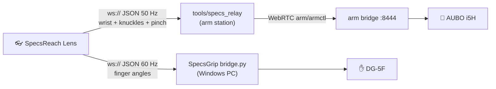

# SpecsReach

Control an **AUBO i5H robot arm** and its **Tesollo DG-5F hand** with your bare
hands through **Snap Spectacles**. SpecsReach is the arm's counterpart to
SpecsGrip: SpecsGrip drove the hand, and SpecsReach adds the arm under it.

- **Left pinch** grabs the arm. While you hold it, the arm's tool follows your
  **right wrist**: it moves and turns as your wrist does.
- **Right fingers** drive the DG-5F's 20 joints, exactly as in SpecsGrip.
- **Releasing the pinch** stops the arm smoothly where it is. Pinch again from a
  comfortable spot to reach further.

## How it fits together

| Part | Where | What it does |
|---|---|---|
| `Assets/Scripts/ArmTeleop.ts` | Lens | Sends the drive hand's wrist and knuckles, the clutch pinch and the head direction, and shows a status HUD. |
| `Assets/Scripts/HandBridge.ts` | Lens | Unchanged copy from SpecsGrip: finger angles to the DG-5F bridge. |
| `teleop/teleop-server/tools/specs_relay/` | Arm station | Turns hand data into arm targets (clutch, frames, filtering, limits) and speaks the existing arm-bridge protocol. Read [its README](teleop/teleop-server/tools/specs_relay/README.md). |
| `teleop/teleop-server/arm_bridge/` | Arm station | The existing bridge. It is unchanged and owns all arm safety. |

## Setup

1. **Arm station:** start the arm bridge as usual. Then run the relay (exact
   command in the relay README) and note the `Lens URL` it prints.
2. **Hand PC:** start SpecsGrip's `bridge.py` as before and note its URL.
3. **Lens Studio:** in this project's scene:
   1. Add an empty object **ArmTeleop** with the `ArmTeleop` script, and put
      the relay URL in **Server Url**.
   2. Add an object **HandBridge** with the `HandBridge` script, and put the
      DG-5F bridge URL in **Server Url**.
   3. Optional but recommended: add a Text under the Camera for each script's
      **Status Text**.
4. **Push to the Spectacles.** Lens Studio Preview can't open network
   connections, so test on the glasses.
5. **Enable the arm:** type `e` + Enter in the relay terminal. Wait for the
   HUD to turn green.
6. **Drive:** show your right hand and pinch with your left.

All three devices must be on the same private Wi-Fi.

## Safety

- The arm bridge's limits apply unchanged: workspace box, keep-outs, IK holds,
  speed and acceleration ramps, the elbow guard, and the 300 ms watchdog.
- The relay refuses to engage on a stale or faulted arm. It also drops the
  deadman within 150 ms if the glasses go quiet or either hand leaves view.
- Power-on is always an operator action (relay key `e`).
- Keep a hand near the pendant e-stop for the first sessions.

**Re-commission when the DG-5F is mounted.** Update the AUBO `tcp_offset` and
`payload` in `teleop/teleop-server/config/arm_bridge.yaml` once the hand is on
the flange.
