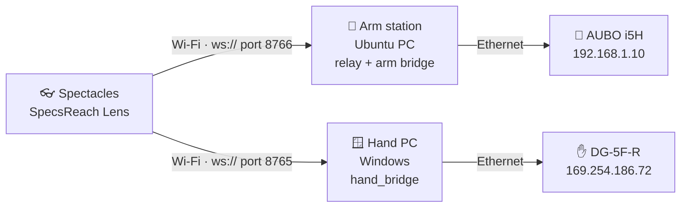
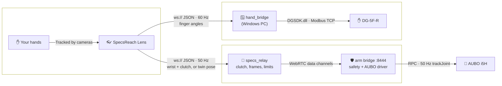
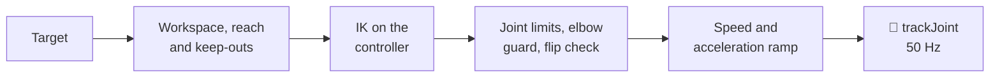

<h1 align="center">😎 SpecsReach 🦾</h1>

<p align="center">
  Control an <b>AUBO i5H robot arm</b> and the <b>Tesollo DG-5F robot hand</b> on it with your bare hands through <b>Snap Spectacles!</b><br>
  Pinch to grab the arm and its tool follows your wrist while your fingers drive the hand. Or drag a 3D twin of the arm in front of you, and the real one follows.
</p>

<p align="center">
  <a href="#features">✨ Features</a> •
  <a href="#supported-devices">🦾 Hardware</a> •
  <a href="#setup">🚀 Setup & Guide</a> •
  <a href="#controls">🎮 Controls</a> •
  <a href="#how-it-works">⚙️ How it works</a> •
  <a href="#troubleshooting">🛠️ Troubleshoot</a> •
  <a href="#structure">📁 Project Structure</a>
</p>

<!-- Demo video goes here. -->

SpecsReach is the arm's counterpart to [SpecsGrip](https://github.com/amirmohideen/SpecsGrip): SpecsGrip drives the hand, SpecsReach adds the arm under it. This repo holds everything for both: the Lens, the arm station (relay + arm bridge, in Docker) and a copy of SpecsGrip's hand bridge.

---

<a id="features"></a>
## ✨ Features

| Feature | Description |
| :--- | :--- |
| 🖐️ **Bare-hand arm teleop** | Pinch with your left hand to grab the arm. While you hold it, the tool follows your right wrist 1:1. Let go and the arm stops where it is. |
| ✊ **Arm and hand together** | Your right fingers drive all 20 joints of the DG-5F at the same time, through SpecsGrip's bridge. |
| 🔘 **Pinch or toggle** | Hold a pinch to drive, or switch to a **DRIVE** button that starts and stops the grab. |
| 🤖 **Digital twin** | A 3D model of the arm floats in front of you and mirrors the real one. Pinch a part and drag it: the real arm follows at a capped speed. |
| 🧭 **Wrist axes** | The arm's X/Y/Z axes are drawn at your wrist, so you can see which way it will move before you grab. |
| 🛡️ **Safety first** | The arm only powers on from the station keyboard. The arm bridge refuses targets outside its workspace, joint limits and keep-out zones, caps speed and acceleration, and holds the arm when the signal drops. |
| 🎛️ **Tune without rebuilding** | The hand-to-arm mapping and the arm's limits live in two files on the station. Edit, restart, done: no Lens rebuild or re-push. |
| 🐳 **One Docker image** | The arm bridge and the relay run in one image built from `station/Dockerfile`. Nothing else to install on the station. |

---

<a id="supported-devices"></a>
## 🦾 Supported Hardware

| Device | Type | Status | Notes |
| :--- | :--- | :--- | :--- |
| **Spectacles (2024)** | Glasses | ✅ Supported | Camera-based hand tracking: keep your hands in view and in reasonable light. |
| **Specs (2026)** | Glasses | ⚠️ Need to test | — |
| **AUBO i5H** on a CB-M control box | Robot arm | ✅ Supported (ARCS 0.32.1, SDK interface 0.26.0) | The reference hardware. The controller must run AUBO's **ARCS** software. |
| AUBO on another ARCS version | Robot arm | ⚠️ Need to test | Change the `pyaubo-sdk` pin in `station/Dockerfile` to the SDK version on the pendant. |
| AUBO on legacy AUBOPE 4.x | Robot arm | ❌ Not supported | A different SDK. |
| **Ubuntu 24.04 PC** | Arm station | ✅ Supported | Runs the arm bridge and the relay. Needs Wi-Fi and one Ethernet port for the arm. |
| **Delto DG-5F-R** (right) | Robot hand | ✅ Supported (DGSDK 2.0.0, firmware 769) | Optional. See [SpecsGrip](https://github.com/amirmohideen/SpecsGrip) for left and S variants. |
| **Windows 11 PC** | Hand bridge host | ✅ Supported | Only for the hand: needs Tesollo **DGManager**, whose `DGSDK.dll` the bridge uses. |
| **Mac or Windows PC** | Lens Studio | ✅ Supported (Lens Studio 5.15) | Only to push the Lens. Lens Studio doesn't run on Linux. |

---

<a id="setup"></a>
## 🚀 Setup & Guide

Three machines share one private Wi-Fi. Each robot hangs off its own PC by Ethernet, and the glasses talk to both PCs:



**What you need**

| | |
| :--- | :--- |
| 🦾 **AUBO i5H** | On an ARCS controller, with an Ethernet cable to the station |
| 🐧 **Ubuntu 24.04 PC** | Wi-Fi plus an Ethernet port, with Docker, `git` and `git-lfs` |
| ✋ **DG-5F-R + Windows PC** | Optional: DGManager installed, Python 3 (tested on 3.13) |
| 👓 **Spectacles (2024)** | Plus a Mac or Windows PC with Lens Studio 5.15 to push the Lens |
| 📶 **One private Wi-Fi** | For the glasses, the station and the hand PC. Public and guest Wi-Fi usually stop devices from reaching each other. |

<details open>
<summary><b>🐧 1. Arm station (Ubuntu PC + AUBO)</b></summary>
<br>

1. **Get the code.** The 3D models and Lens packages are stored with Git LFS, so install it before you clone:
   ```bash
   sudo apt install git git-lfs
   git lfs install
   git clone https://github.com/amirmohideen/SpecsReach.git
   cd SpecsReach
   ```

2. **Set up the AUBO controller** on its teach pendant:
   - **2.1** Check that it runs ARCS: the **About** screen shows an *SDK Interface Version*. SpecsReach is built for **0.26.0**. For another version, change the `pyaubo-sdk` pin in `station/Dockerfile` to match.
   - **2.2** Give the controller a static address: **Settings → System → Network**, `192.168.1.10/24`. Any address works if you put it in `aubo.host` in `station/arm_bridge.yaml`.
   - **2.3** Copy the bridge's joint limits into the pendant's safety settings: J2 within ±160° and J3 (the elbow) within ±150°. From the factory every joint allows ±360°, which is not a safe limit.
   - **2.4** Set the controller's **home position** to an open, unfolded pose, for example AUBO's ready pose `[0, -15, 100, 25, 90, 0]°`. The relay's `h` key moves the arm there, and the bridge refuses a home outside its joint limits. A folded home makes the forearm collide with the upper arm.
   - **2.5** Never drive the arm from the pendant and from SpecsReach at the same time.

3. **Connect the station to the arm.** Plug in the Ethernet cable. Give that port a static address that never takes the default route, so the Wi-Fi keeps carrying everything else:
   ```bash
   nmcli con show                       # find the Ethernet connection's name
   sudo nmcli con mod "<ethernet-connection>" ipv4.method manual \
        ipv4.addresses 192.168.1.154/24 ipv4.gateway "" ipv4.never-default yes ipv6.method link-local
   sudo nmcli con up "<ethernet-connection>"
   ping -c 3 192.168.1.10
   ```

4. **Install Docker and build the station image.** Install Docker Engine following [Docker's Ubuntu guide](https://docs.docker.com/engine/install/ubuntu/), then:
   ```bash
   sudo usermod -aG docker $USER        # then log out and back in
   docker build -t specsreach-station station/
   ```
   The image holds Python, GStreamer's WebRTC stack and AUBO's SDK. The code itself stays in the repo, so config edits never need a rebuild.

5. **Configure the arm** in [`station/arm_bridge.yaml`](station/arm_bridge.yaml):
   - `aubo.host`: the controller's address, if it isn't `192.168.1.10`.
   - **With the DG-5F mounted on the flange**, set `tcp_offset` z to the hand's centre and `payload_kg` / `payload_cog` to its mass and centre of gravity. The bridge writes these to the controller when it connects. Keep the `tcp_offset` yaw at `90`: the relay and the digital twin rely on it.

6. **Open the firewall for the glasses** (only if `ufw` is on). Use your Wi-Fi's subnet:
   ```bash
   sudo ufw allow from 192.168.124.0/24 to any port 8766 proto tcp
   ```

7. **Run the preflight.** It prints the exact URL the Lens needs, and flags anything that will block it. It is read-only:
   ```bash
   python3 station/netcheck.py
   ```

8. **Start the arm bridge.** It runs in the background and starts again with the PC:
   ```bash
   station/start_bridge.sh
   ```
   Wait for `arm bridge: signaling ws://:8444 arm=aubo`. The bridge connects to the controller first; until it can, it exits and Docker retries every few seconds.

   | | |
   | :--- | :--- |
   | Logs | `docker logs -f specsreach-arm` |
   | Stop | `docker rm -f specsreach-arm` |

   > 💡 Already running another arm bridge on this PC, such as teleop-server's? Then skip this step: the script refuses to start a second one, and the relay works with either.

9. **Start the relay.** Keep this terminal open: the relay takes keyboard commands.
   ```bash
   station/start_relay.sh
   ```
   The relay only connects to the bridge while a Lens is connected, plus 10 seconds, so it never blocks other clients for long.

</details>

##

<details open>
<summary><b>✋ 2. Robot hand (Windows PC, optional)</b></summary>
<br>

The hand runs on SpecsGrip's bridge, included in [`hand_bridge/`](hand_bridge/). Its own [README](hand_bridge/README.md) has the full reference (tuning, HUD states, firewall details).

1. **Get the code on the Windows PC:** clone SpecsReach there too, or copy just the `hand_bridge` folder.
2. **Connect the robot hand:**
   - **2.1** Plug the DG-5F-R into the PC by Ethernet and connect once in **DGManager** to confirm it works. The defaults are TCP `169.254.186.72`, port `502`, model **Delto Gripper-5F-Right**, in **Developer** mode. If yours differ, update the `gripper` section of `hand_bridge/config.json`.
   - **2.2** **Close DGManager.** The hand only accepts one client at a time.
   - **2.3** Check the connection. This never engages the servos, so the hand can't move:
     ```bash
     cd path\to\SpecsReach\hand_bridge
     py connecttest.py
     ```
     You should see `SEQUENCE OK` and the hand's live joint angles.
3. **Put the PC on the shared Wi-Fi:**
   - **3.1** Join the same private Wi-Fi as the glasses. When Windows asks *"Allow your PC to be discoverable on this network?"*, choose **Yes**, which marks it **Private**.
   - **3.2** In an **admin** PowerShell, allow the bridge through the firewall (one time):
     ```powershell
     New-NetFirewallRule -DisplayName "Delto Hand Bridge" -Direction Inbound -Protocol TCP -LocalPort 8765 -Action Allow -Profile Private
     ```
   - **3.3** Run the network preflight. It prints the URL the Lens needs:
     ```bash
     py netcheck.py
     ```
4. **Start the hand bridge:**
   ```bash
   py bridge.py
   ```
   Wait for `gripper ready`. It starts **DISARMED**: nothing moves until you press `space`.

</details>

##

<details open>
<summary><b>👓 3. The Lens (Lens Studio)</b></summary>
<br>

1. **Get the code on the Mac** (or Windows PC) with Lens Studio 5.15: install Git LFS (on a Mac, `brew install git-lfs`, then `git lfs install`) and clone SpecsReach.
2. **Open `SpecsReach.esproj`** in Lens Studio.
3. **Point the Lens at the arm station:** select the **ArmTeleop** object and, on its **ArmRelayClient** script, paste the URL from `station/netcheck.py` into **Server Url**, for example `ws://192.168.124.3:8766`.
   > ⚠️ The saved value is the author's network and won't work for you. You can enter several URLs separated by commas: the Lens tries each in turn, which saves a re-push when an IP changes.
4. **Point it at the hand PC:** select **RoboHandBridge** and paste the URL from the hand PC's `py netcheck.py` into its **Server Url**. Skip this without a hand.
5. **Push the Lens to your Spectacles.** The project uses Experimental APIs (they allow `ws://` on a local network), so it can be pushed from Lens Studio but not published to Lens Explorer.
6. **Quit Lens Studio before you drive.** Its Preview runs the same Lens, connects to the relay too and takes over from the glasses. The Lens keeps running on the glasses on its own.

</details>

##

<details open>
<summary><b>▶️ 4. First run</b></summary>
<br>

1. **Station:** the arm bridge is running (step 1.8) and the relay terminal is open (step 1.9).
2. **Hand PC:** `py bridge.py` says `gripper ready`.
3. **Glasses:** open the Lens. The HUD shows the relay connected and `bridge: connected`, and the relay prints `Lens hello from spectacles`.
4. **Power on the arm:** type `e` + Enter in the relay terminal. Brake release takes a few seconds; the HUD turns green when the arm reads `SERVO`.
5. **Drive:** pick **Teleop** in the Lens menu. Show your right hand, pinch with your left and move slowly. Open the pinch to stop.
6. **Hand:** press `space` on the hand PC to arm it. Your right fingers now drive the DG-5F.

> ⚠️ **This moves a real robot arm. Keep a hand on the pendant's e-stop**, especially in your first sessions. Spectacles deliver hand data in bursts, so the arm follows about 0.3 to 1 s behind your hand, and opening the pinch can take up to 1 s to register. To stop fast, use the e-stop.

</details>

##

<details close>
<summary><b>🧪 Testing without Spectacles or the robot (for developers)</b></summary>
<br>

You can run the whole station path without the glasses, and without the arm. All commands run from the repo root.

1. **Relay unit tests** (the mapping and clutch logic):
   ```bash
   docker run --rm -v "$PWD":/workspace -w /workspace specsreach-station \
     python3 -m unittest discover -s specs_relay/tests
   ```
2. **A mock arm.** [`station/mock.yaml`](station/mock.yaml) runs the arm bridge with no hardware: the "arm" jumps to each target the bridge accepts. Use spare ports so it never meets the real bridge or relay:
   ```bash
   CONFIG=station/mock.yaml SIGNALING_PORT=8454 station/start_bridge.sh
   NAME=specsreach-relay-test station/start_relay.sh --bridge-port 8454 --port 8776 --auto-enable
   ```
   `--auto-enable` powers the arm on by itself: only ever use it with the mock.
3. **A fake Lens**, in a second terminal. `fake_lens.py` rests, pinches, moves the wrist 3 cm forward and back, and lets go. `fake_twin.py` does the same through the digital twin:
   ```bash
   docker run --rm --network host -v "$PWD":/workspace -w /workspace specsreach-station \
     python3 specs_relay/fake_lens.py --url ws://127.0.0.1:8776 --axis forward --cm 3
   docker run --rm --network host -v "$PWD":/workspace -w /workspace specsreach-station \
     python3 specs_relay/fake_twin.py ws://127.0.0.1:8776
   ```
   When you're done, type `q` in the test relay's terminal and stop the mock: `docker rm -f specsreach-arm-mock`.
4. **The hand without the hand** (on the Windows PC): `py bridge.py --dry-run --auto-arm` never connects to the gripper, and `py test_sender.py --wave` feeds it synthetic poses. See [`hand_bridge/README.md`](hand_bridge/README.md).

Tuning lives in [`specs_relay/specs_relay.json`](specs_relay/specs_relay.json); the full reference is in [`specs_relay/README.md`](specs_relay/README.md).
</details>

---

<a id="controls"></a>
## 🎮 Controls

The Lens opens on a menu with two modes: **Teleop** and **Digital Twin**.

**Teleop**

| You | The robot |
| :--- | :--- |
| 🤏 **Left pinch, held** | Grabs the arm. Open the pinch to let go: the arm stops smoothly where it is. |
| 🔘 **DRIVE button** (toggle mode) | Starts and stops the grab instead of a held pinch. Press it with your **left** hand. Switch to toggle mode with the clutch switch, or set ArmRelayClient's **Clutch Mode**. |
| ✋ **Right wrist** | While grabbed, the tool moves as your wrist moves, 1:1. |
| 🖐️ **Right fingers** | Drive the DG-5F, whenever the hand bridge is armed. |

To reach further, let go, move your hand back, and grab again. The directions are set when you grab: arm **+X** is the way you were looking, **+Y** your left, **+Z** up. Turning your head mid-grab changes nothing.

**Digital Twin**

| Pinch and drag | Does |
| :--- | :--- |
| 🔧 **The tool** (flange) | The tool moves with your hand; the joints follow. |
| 🦴 **An arm segment** | Turns that segment's joint. |
| 🧱 **The base** | Moves the model in the room. The real arm doesn't move. |

Letting go stops the real arm where it is. The real arm chases the model at a capped speed (60 mm/s and 20°/s), so it trails behind a quick drag.

**Station keyboard** (relay terminal, each key + Enter)

| Key | Action |
| :--- | :--- |
| **`e`** / **`d`** | Enable (power on + brake release) / disable (**power off**, brakes on) |
| **`h`** / **`x`** | Move to the controller's home position / cancel |
| **`r`** | Recover: clear a fault or protective stop |
| **`t`** | Retreat slowly back inside the safe envelope |
| **`c`** | Calibrate the room frame (press twice) |
| **`v`** | Back to view mode (the default) |
| **`s`** | Print the status |
| **`q`** | Quit. The arm holds where it is. |

Arm keys are refused while you are holding a grab: let go first.

**Hand PC keyboard** (`bridge.py`)

| Key | Action |
| :--- | :--- |
| **`space`** | Arm / disarm the hand |
| **`n`** | Slowly return the hand to neutral |
| **`q`** | Quit (returns to neutral, then disconnects) |

---

<a id="how-it-works"></a>
## ⚙️ How it works

<details open>
<summary><b>📐 System Architecture</b></summary>
<br>



Spectacles can open a WebSocket but not a WebRTC connection, which is why the relay sits in front of the arm bridge. To the bridge, the relay looks like any other headset.

</details>

##

<details open>
<summary><b>📖 Technical Deep Dive</b></summary>
<br>

**1. The Lens only measures:** <br>

`ArmRelayClient.ts` sends 50 times a second: your right wrist and three knuckles (cm, in the Lens's world), the clutch, and where your head is looking:

```json
{
  "type": "hand",
  "t": 12345,
  "drive": {"tracked": true, "wrist": [12.3, -20.1, -40.5], "index": [10.4, -19.8, -48.6],
            "middle": [12.4, -19.9, -49.0], "pinky": [15.9, -20.2, -47.4]},
  "clutch": {"tracked": true, "pinch": true, "mode": "pinch"},
  "head": {"fwd": [0.05, -0.2, -0.98]}
}
```

In Digital Twin mode it sends the model's tool target instead: `{"type": "twin", "active": true, "pose": [x, y, z, roll, pitch, yaw]}`, in the arm's own frame. `HandBridge.ts` separately sends 20 finger angles to the hand PC. Every decision about how your hand maps onto the robot lives on the PCs, so you can retune without rebuilding the Lens.

##

**2. The relay turns your hand into arm targets:** <br>

- 🔒 **Engaging needs everything ready:** a fresh pinch, a fresh arm status that reads `SERVO`, no fault, and your right hand in view.
- 🧭 **The frame is frozen at the grab.** Your horizontal look direction becomes arm +X, and both your wrist and the arm's tool are anchored there.
- 📏 **The arm moves by how far your wrist moves**, never to where it is, so grabbing never makes the arm jump. The first 1.5 cm is ignored, then the motion is smoothed, kept within 500 mm of the anchor per axis, and capped at 250 mm/s.
- 📶 **It rides out the glasses' pauses.** Spectacles send hand data in bursts: on the station, nothing new had arrived for over 0.1 s 70% of the time, and pauses reached about 1 s. The relay keeps the grab through up to 1 s of silence, gliding toward the last reported hand position (never past it).
- ✋ **It lets go** when the pinch opens for 0.15 s, a hand leaves view, the arm faults, or the glasses go silent for 1 s.

##

**3. The arm bridge owns all arm safety:** <br>



- 🚫 A target outside the workspace or inside a keep-out zone is **refused, never clamped**: the arm holds at its last good target.
- 🦴 The elbow never straightens fully (a singular pose) and no joint passes its configured limit. A pose the controller's IK can't reach, or that would flip the arm's configuration, is held too.
- 🧊 If heartbeats stop for 1 s, the bridge holds the arm. Letting go stops it with one smooth controller stop.
- 🎯 The bridge's 50 Hz servo loop is the only thing that ever commands the arm, so nothing on the network can block or race it.

##

**4. The hand bridge** is SpecsGrip's: it scales your finger angles into each joint's range, clamps them to factory-proven limits, smooths them and caps joint speed at 200°/s. If packets stop for 300 ms, the hand freezes in place. Details in [`hand_bridge/README.md`](hand_bridge/README.md).

</details>

---

<a id="troubleshooting"></a>
## 🛠️ Troubleshooting Guide

| Symptom | Things to try |
| :--- | :--- |
| 📵 **HUD shows `CLOSED`, code 1006** | The glasses never reached the station. Use the **Wi-Fi** URL from `python3 station/netcheck.py`, not the arm's `192.168.1.x` cable address. Check the firewall rule (step 1.6), and that the glasses are on the same, private Wi-Fi. |
| 🔁 **Relay keeps printing `a second Lens connected: replacing the old connection`** | Two copies of the Lens are connected, usually Lens Studio's Preview on your Mac. Quit Lens Studio. |
| ✋ **Grabs drop after a moment: `released: Lens silent`** | The glasses paused longer than `lens_timeout_s` (1 s). Raise it a little in `specs_relay/specs_relay.json` if your glasses pause longer; the arm glides on old data for that long. |
| 🟡 **HUD says `bridge: connecting` or the arm reads `NO STATUS`** | The arm bridge isn't running or can't reach the arm: `docker logs specsreach-arm`. |
| 🧊 **`engage refused: arm is ...`** | The arm isn't powered on: press `e`. After a protective stop or the e-stop, press `r`, then `e`. |
| ⛔ **`arm outside envelope`** (warn 1006) | The arm is outside its safe envelope: press `t` and it retreats slowly back inside. |
| ↩️ **`joint limit / arm stretched`** (warn 1002), **out of reach** (1001), **singularity** (1003), **would self-collide** (1005) | The bridge is holding a target it won't follow. Move your hand back, or let go and grab again nearer the arm. |
| 🧭 **The arm moves the wrong way** | Set `view_yaw_deg` in `specs_relay/specs_relay.json` to the way you face the arm (0 = you look along its +X), and the same value in ArmRelayClient's **View Yaw Deg**. |
| 🔌 **`start_bridge.sh`: port 8444 is already in use** | Another arm bridge is running. Use it (the relay works with any), or stop it first. |
| 🔁 **The bridge keeps restarting with `connect failed`** | It can't reach the controller, or the SDK doesn't match. Run `python3 station/netcheck.py`, and compare the pendant's SDK version with the `pyaubo-sdk` pin in `station/Dockerfile`. |
| 👻 **`a relay is already running`**, or `address already in use` on 8766 | Use the relay that's running, or type `q` in its terminal (or `docker rm -f specsreach-relay`). |
| 🔑 **Arm keys do nothing: `release the pinch first`** | The relay refuses arm commands mid-grab. Let go first. |
| 〰️ **Jittery arm** | Raise `filter_tau_s` in `specs_relay/specs_relay.json` (smoother, a little laggier), and keep `enable_orientation` false. |
| 🐢 **Laggy arm** | Lower `filter_tau_s` (snappier, more jitter). Some lag always comes from the glasses' bursts. |
| ✋ **The robot hand misbehaves** | See the [hand bridge troubleshooting](hand_bridge/README.md): DGManager still open, `NOT_FOUND_MODEL`, a finger moving the wrong way, and more. |

---

<a id="structure"></a>
## 📁 Project Structure

```
SpecsReach/
├── SpecsReach.esproj        # Lens Studio project file (open this in Lens Studio)
├── Assets/
│   ├── Scene.scene          # the Lens scene
│   ├── Scripts/             # the Lens logic (table below)
│   └── Auboi5Model/         # the AUBO i5H link meshes for the digital twin
├── Packages/                # Snap's Spectacles Interaction Kit and UI Kit
├── station/                 # arm station: Docker image, arm config, start scripts, preflight
├── specs_relay/             # the relay: Lens WebSocket -> arm bridge
├── arm_bridge/              # the arm bridge: safety + the AUBO driver
└── hand_bridge/             # SpecsGrip's bridge for the DG-5F (Windows PC)
```

**`Assets/Scripts/` - the Lens**

| Script | What it does |
| :--- | :--- |
| 🔀 `ArmRelayClient.ts` | The connection to the relay. Sends the drive hand, the clutch and the head direction (or the twin's target), reconnects through several server URLs, and shows the status HUD. |
| 🔘 `ClutchStateMachine.ts` | The clutch: hold-a-pinch (default) or the DRIVE toggle button. |
| 🧭 `WristAxesGizmo.ts` | Draws the arm's X/Y/Z axes at your right wrist. |
| 📋 `ModeSelectMenu.ts` | The main menu and switching between Teleop and Digital Twin. |
| 🤖 `ArmDigitalTwin.ts` | The digital twin: builds the model, handles pinch and drag, and highlights the part under your hand. |
| 📐 `AuboKinematics.ts` | AUBO i5H forward and inverse kinematics, from the URDF. |
| 🖐️ `HandBridge.ts` | From SpecsGrip: measures 20 finger angles and streams them to the hand bridge. |

**`station/` - the arm station**

| File | What it does |
| :--- | :--- |
| 🐳 `Dockerfile` | The `specsreach-station` image: Python, GStreamer WebRTC, PyYAML, websockets and AUBO's SDK. |
| ⚙️ `arm_bridge.yaml` | The arm's config: controller address, tool offset and payload, joint limits, workspace. |
| 🧪 `mock.yaml` | The same bridge with no hardware, for testing. |
| ▶️ `start_bridge.sh` | Starts the arm bridge in the background (refuses if another bridge holds the port). |
| ▶️ `start_relay.sh` | Starts the relay in your terminal. |
| 📡 `netcheck.py` | Preflight: prints the Lens URL and checks the arm, the ports, the image and the firewall. |

**`specs_relay/` - the relay** ([reference](specs_relay/README.md))

| File | What it does |
| :--- | :--- |
| 🧠 `specs_relay.py` | The relay. WebSocket server for the Lens, WebRTC peer of the arm bridge, keyboard commands. |
| 📐 `teleop_map.py` | The mapping: clutch, frames, filtering and limits. Pure logic, unit tested. |
| ⚙️ `specs_relay.json` | All relay tuning in one place. |
| 🧪 `fake_lens.py` / `fake_twin.py` | Stand-ins for the Lens, for testing without glasses. |
| ✅ `tests/` | Unit tests for the mapping and clutch rules. |

**`arm_bridge/` - the arm bridge** ([notes](arm_bridge/README.md))

The Python package that drives the AUBO: the WebRTC transport, the session and safety checks, the 50 Hz servo loop, and the AUBO driver. It's trimmed to what SpecsReach needs; the `mock` backend is kept for testing.

**`hand_bridge/` - the robot hand** ([reference](hand_bridge/README.md))

A copy of SpecsGrip's `bridge/` folder: `bridge.py`, its SDK binding, retargeting, WebSocket server, `config.json`, and the `netcheck`, `connecttest`, `selftest` and `test_sender` helpers.

---

<a id="license"></a>
## 📄 License & Credits

<i>SpecsReach is distributed under the <a href="LICENSE">MIT License</a>.</i>

- **The arm bridge** (`arm_bridge/`) comes from the teleop-server project (commit `4cd4187`), trimmed to what drives the AUBO.
  <!-- TODO before publishing: state the license that covers arm_bridge/. -->
- **The hand bridge** (`hand_bridge/`) and `HandBridge.ts` come from [SpecsGrip](https://github.com/amirmohideen/SpecsGrip) (MIT, commit `738b92b`).
- **The AUBO i5H model:** the meshes in `Assets/Auboi5Model/` were converted from the visual meshes in [AuboRobot/aubo_description](https://github.com/AuboRobot/aubo_description) (commit `47fa5e0`), which its `package.xml` lists as BSD-licensed. The URDF in `arm_bridge/` and the kinematics in `AuboKinematics.ts` come from the same source.
- **AUBO's SDK** (`pyaubo-sdk`) is installed from PyPI when the image is built, and **Tesollo's DGSDK** ships with DGManager. Neither is included here.
- **Spectacles Interaction Kit and Spectacles UI Kit** (`Packages/`) are by Snap Inc. and covered by Snap's own terms, not this repo's license.

Created by <a href="https://github.com/amirmohideen">Amir Mohideen Basheer Khan</a>

📁 [Source Repo](https://github.com/amirmohideen/SpecsReach)
