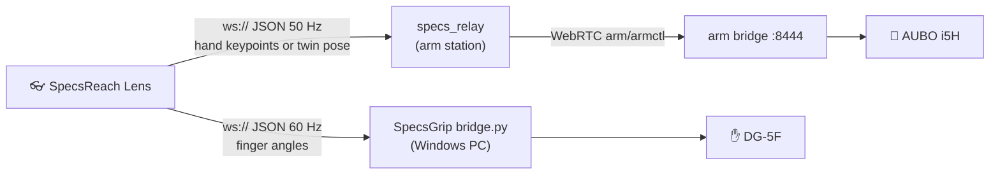

# SpecsReach

Control an **AUBO i5H robot arm** and its **Tesollo DG-5F hand** with your bare
hands through **Snap Spectacles**. SpecsReach is the arm's counterpart to
[SpecsGrip](https://github.com/amirmohideen/SpecsGrip): SpecsGrip drives the
hand, and SpecsReach adds the arm under it.

<!-- Demo GIF or video goes here. -->

The Lens opens on a menu with two modes:

- **Teleop:** pinch with your left hand to grab the arm. While you hold it,
  the arm's tool follows your right wrist, and your right fingers drive the
  DG-5F. Let go and the arm stops where it is.
- **Digital Twin:** a 3D model of the arm floats in front of you and mirrors
  the real one. Pinch a part of the model and drag it, and the real arm
  follows.

## How it fits together

The Lens only measures and sends. The relay holds the control logic (clutch,
frames, filtering, speed and range limits), and the arm bridge owns all arm
safety. Spectacles can open a WebSocket but not a WebRTC connection, which is
why the relay sits in between.

| Part | What it does |
|---|---|
| `Assets/Scripts/ArmRelayClient.ts` | The connection to the relay. Sends the drive hand's wrist and knuckles, the clutch, the head direction (or the twin's target in twin mode), and shows a status HUD. |
| `Assets/Scripts/ClutchStateMachine.ts` | The clutch: hold-a-pinch (default) or a DRIVE toggle button. |
| `Assets/Scripts/WristAxesGizmo.ts` | Draws the arm's X/Y/Z axes at your right wrist in teleop. |
| `Assets/Scripts/ModeSelectMenu.ts` | The main menu and switching between modes. |
| `Assets/Scripts/ArmDigitalTwin.ts` | The digital twin: builds the model, handles pinch and drag, highlights parts on hover. |
| `Assets/Scripts/AuboKinematics.ts` | AUBO i5H forward and inverse kinematics, taken from the URDF. |
| `Assets/Scripts/HandBridge.ts` | From SpecsGrip: finger angles to the DG-5F bridge. |
| `specs_relay/` | The relay. Turns hand or twin data into arm targets and speaks the arm bridge's protocol. See [its README](specs_relay/README.md). |

## What you need

- **Snap Spectacles** and **Lens Studio 5.15**.
- **An AUBO i5H** with its arm bridge running on a station PC. The arm bridge
  comes from the teleop-server project and is **not included** in this repo;
  the relay runs next to it and imports its `arm_bridge` package.
- **Optional: a Tesollo DG-5F** on a Windows PC running the SpecsGrip bridge.
- **One private Wi-Fi network** for all of them. The relay listens on TCP 8766
  and the hand bridge on 8765.

The models and packages are stored with **Git LFS**, so install `git-lfs`
before cloning.

## Setup

1. **Arm station:**
   1. Copy `specs_relay/` into the teleop-server tree as
      `tools/specs_relay/`.
   2. Start the arm bridge as usual, then start the relay (the exact command
      is in the [relay README](specs_relay/README.md#run-on-the-station)).
   3. Note the `Lens URL` the relay prints.
2. **Hand PC (optional):** set up and start SpecsGrip's `bridge.py`
   ([SpecsGrip setup](https://github.com/amirmohideen/SpecsGrip#-setup--guide))
   and note its URL.
3. **Lens Studio:** open this project, then:
   1. Select the **ArmTeleop** object and, on its `ArmRelayClient` script,
      put the relay URL in **Server Url**.
   2. Select **RoboHandBridge** and put the hand bridge URL in its
      **Server Url**.
4. **Push to the Spectacles.** Lens Studio Preview can't open network
   connections, so test on the glasses. The project uses Experimental APIs,
   so push it from Lens Studio; it can't be published to Lens Explorer.
5. **Enable the arm:** type `e` + Enter in the relay terminal and wait for the
   HUD to turn green.
6. **Pick a mode** from the menu.

## Controls

**Teleop**

| Hand | Does |
|---|---|
| Left pinch, held | Grabs the arm. Open the pinch to let go: the arm stops smoothly where it is. |
| DRIVE button (toggle mode) | Starts and stops the grab instead of a held pinch. Press it with your left hand. Turn toggle mode on with the clutch switch or ArmRelayClient's **Clutch Mode**. |
| Right wrist | While grabbed, the tool moves (and, if enabled, turns) as your wrist does. |
| Right fingers | Drive the DG-5F. |

To reach further, let go, move your hand back, and grab again.

**Digital Twin**

| Pinch and drag | Does |
|---|---|
| The tool (flange) | The tool moves with your hand; the joints follow. |
| An arm segment | Turns that segment's joint. |
| The base | Moves the model in the room. The real arm doesn't move. |

Letting go stops the real arm where it is. The real arm chases the model at a
capped speed (60 mm/s and 20°/s by default), so it trails behind a quick drag.

## Customizing

- **Relay tuning** lives in `specs_relay/specs_relay.json`: speeds, filtering,
  whether the tool follows wrist rotation, the twin's speed limits, and more.
  Edit it and restart the relay; the Lens doesn't need a rebuild.
- **ArmRelayClient** has the clutch mode, which hand drives, the view direction
  (`View Yaw Deg`), and an optional text that shows DRIVE ON/OFF.
- **ArmDigitalTwin** has the model's scale and spawn spot, and its materials: Arm
  Material, per-part **Link Materials**, a Ghost Material for the drag
  preview, and hover and grab outline colors.

## Safety

- The arm bridge's limits apply unchanged: workspace box, keep-outs, IK holds,
  speed and acceleration ramps, the elbow guard, and the watchdog.
- The relay refuses to engage on a stale or faulted arm. It lets go of the arm
  when the clutch opens, either hand leaves view, or the glasses go quiet for
  `lens_timeout_s` (1 s by default).
- Power-on is always an operator action (relay key `e`). The Lens can't
  enable the arm.
- Keep a hand near the pendant e-stop, especially in your first sessions.
- **Re-commission when the DG-5F is mounted:** update the AUBO `tcp_offset`
  and `payload` in the arm bridge's config once the hand is on the flange.

This project moves a real robot arm. Use it at your own risk.

## Credits and licenses

- **SpecsReach** is released under the [MIT License](LICENSE).
- **AUBO i5H model:** the meshes in `Assets/` were converted from the visual
  meshes in [AuboRobot/aubo_description](https://github.com/AuboRobot/aubo_description)
  (commit `47fa5e0`), which its `package.xml` lists as BSD-licensed. The
  kinematics in `AuboKinematics.ts` come from the same URDF.
- **Spectacles Interaction Kit and Spectacles UI Kit** (`Packages/`) are by
  Snap Inc. and are covered by Snap's own terms, not this repo's license. The
  project started from Lens Studio's Spectacles template.
- **DG-5F hand control** comes from [SpecsGrip](https://github.com/amirmohideen/SpecsGrip)
  (MIT).
- **The arm bridge** belongs to the teleop-server project and is not part of
  this repo.
